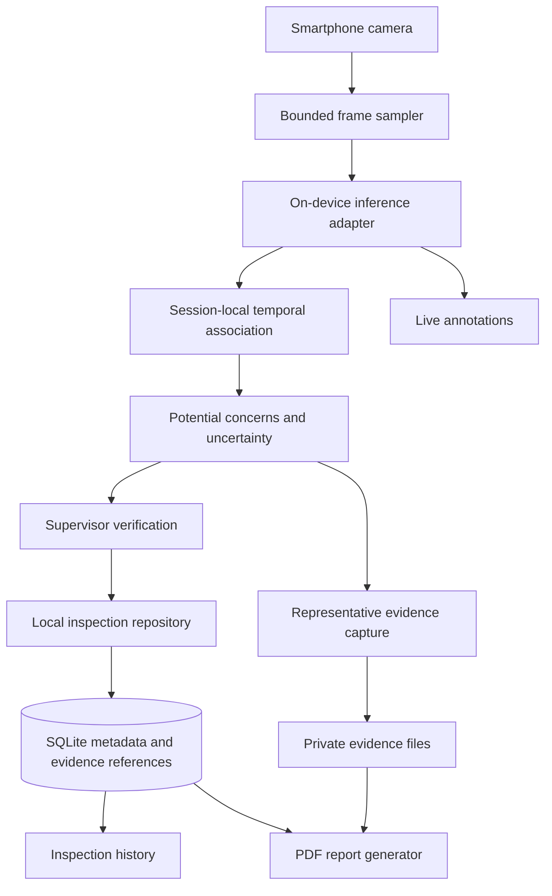

# System architecture

Status: proposed Phase 1 design. The required stack is established; the deployment plugin, model variant, supported devices, package versions, and quantitative budgets remain undecided.

## Local-first design

Use a modular Flutter application rather than mandatory cloud services. Python, PyTorch, Ultralytics YOLO, and optional OpenCV belong to model development and export. Colab provides initial GPU experimentation in Phase 2. The app should not depend on a running Python process, Colab notebook, or backend during inspections.

The diagram describes intended responsibilities, not implemented APIs. No service directory or backend is required for this MVP.

## Modules and responsibilities

| Module | Responsibility and boundary |
| --- | --- |
| Presentation | Session controls, live overlays, history, finding review, report export; display human-verification and uncertainty messaging. |
| Session controller | Lifecycle, active session context, timestamps, cancellation, and rejection of stale results. |
| Camera adapter and sampler | Permissions, rotation, capture, bounded sampling, and lifecycle cleanup. |
| Inference adapter | Model loading, preprocessing, execution, and postprocessing; return class, box, confidence, frame timestamp, and model version without exposing plugin-specific tensors to domain logic. |
| Temporal association | Short-lived spatial/motion association and duplicate suppression within a session; no person identification. |
| Concern assessment | Associate visible PPE with worker regions, apply visibility and confidence rules, and record potential concerns or uncertainty. |
| Evidence manager | Select representative frames, store private image files and annotation metadata, and maintain evidence references. |
| Inspection repository | Transactional SQLite persistence for sessions, findings, review decisions, notes, and evidence references. |
| Report generator | Read a consistent stored inspection view and render a PDF with verified findings, evidence, notes, and uncertainty/disclaimer text. |

Keep domain logic independent of camera, database, inference, and PDF plugins through adapters. A full Flutter framework scaffold and package selection are deferred to the implementation phases.

## Frame processing and assessability

Sample camera frames with at most one in-flight inference and a bounded latest-frame policy. Drop superseded frames instead of building a backlog. Perform inference outside work that blocks Flutter rendering, using the chosen plugin's supported isolate/native execution mechanism. Tune sampling after measurement, rather than assuming camera FPS equals inference FPS.

Normalize orientation, coordinate transforms, color order, resize/letterbox, and normalization consistently with the exported model. Map boxes back to the displayed frame. Carry frame timestamps and session generation tokens so delayed results cannot update a paused, ended, or different session. Avoid retaining frame buffers unnecessarily.

A missing PPE detection alone does not establish a missing item. Evaluate worker/head/torso visibility and association before proposing a concern. Explicitly represent insufficient information; if the selected detector cannot support assessability reliably, expose uncertainty and document that limitation. Do not infer that a site is safe when no concern is detected.

## Association and duplicate handling

Use ephemeral session-local observation IDs, box overlap/motion, PPE type, and configurable temporal windows to group repeated observations. IDs expire, reset between sessions, and must not become employee identifiers. Do not use facial features, identity embeddings, or cross-session matching.

Separate observations from reviewable findings. An existing active finding can accumulate supporting observations instead of triggering repeated alerts. Keep distinct concurrent worker concerns separate where visual evidence supports that distinction. Occlusion, crossings, and scene re-entry can produce merges or duplicates; thresholds and expiry policy require labeled-video evaluation. Do not promise perfect deduplication. Rate-limit visual notifications without silently discarding evidence of distinct concerns.

## Conceptual data model

| Entity | Proposed contents |
| --- | --- |
| InspectionSession | Local ID, site name/location text, start/end timestamps, lifecycle state, notes, model/settings version. |
| Observation | Ephemeral association ID, session ID, timestamp, class, box, confidence, visibility/assessability, candidate PPE concern. Keep transient by default; persist only what is necessary to explain a finding. |
| Finding | Local ID, session ID, PPE concern type, first/last observation times, confidence summary, assessability, review status, corrective-action notes. |
| Evidence | Local ID, finding ID, private relative file reference, capture time, annotation metadata and model version. |
| Review | Finding reference, confirmed/dismissed/unable-to-assess status, decision timestamp and notes; pending is the initial finding state. No worker identity fields. |

This is a conceptual model, not a database migration. Persist final records and review changes transactionally. Store images as private files rather than SQLite blobs. Define atomic file-write, orphan cleanup, and missing-file behavior when persistence is implemented.

## Lifecycle and reporting

Session transitions: idle → active; active → paused; paused → active; active or paused → ended. Ending is final for acquisition; post-session review and reporting remain available. Pausing stops new sampling and rejects late inference results. Persist committed information; after interruption, recover into an explicit interrupted/paused state rather than silently restarting the camera. Exact recovery UX will be specified before implementation.

Finding review states are pending, confirmed, dismissed, and unable to assess. A confirmed finding is a human-reviewed concern, not a compliance certification. Reports distinguish these states; only confirmed findings enter the verified-findings section. If other states are included, place them in separately labeled sections. Export an immutable view with generation time and model provenance. Share/export only by deliberate user action, and clearly handle missing evidence or incomplete review.

## Mobile model tradeoffs

Evaluate Core ML for iOS and LiteRT/TensorFlow Lite for Android, preserving a common domain-level result format. Two native runtimes can improve platform fit but increase export, plugin, and output-parity testing. A single cross-platform plugin may simplify integration but must demonstrate support for the selected model and both device targets.

Before choosing a plugin, check model/export operators, tensor shapes, dynamic/static input handling, NMS placement, precision/quantization, accelerators, preprocessing, licensing, maintenance, and minimum OS versions. Compare PyTorch outputs to each exported artifact and measure concern-level regressions, especially false negatives. Quantization is a candidate optimization, not an assumed requirement. Do not assume a Python-supported model can run in a Flutter package unchanged.

## Privacy and trust boundaries

Camera input, private evidence, SQLite, and generated reports remain local by default. No automatic video recording, upload, analytics, GPS collection, or remote inference is required. Reports and device backups can expose site information, so define retention, deletion, backup exclusion/encryption, and sharing behavior before release. App-private storage alone is not a complete encryption policy. Camera access denial or runtime failure must not be presented as successful assessment.

Model artifacts and datasets have independent licensing and provenance requirements. Avoid private or confidential data in public Git history. Use consented, licensed demo images and disclose known limitations.

## Risks, unresolved questions, and mitigations

| Risk / open decision | Mitigation / decision timing |
| --- | --- |
| Dataset labels may omit vests, full worker boxes, or assessability; absence of annotation can be mistaken for absence of PPE. | Audit candidate label definitions and license in Phase 2; map labels explicitly and inspect missing annotations before training. |
| No chosen YOLO variant, license determination, export version, or Flutter plugin. | Establish a compatibility/license matrix before selecting the model; validate native exports before mobile integration. |
| Missed concerns under occlusion, lighting changes, small workers, or novel sites. | Stratified independent evaluation, recall-focused threshold selection, explicit uncertainty, human verification, limitation records. |
| Duplicate suppression merges distinct workers or hides reappearing concerns. | Session-only association, bounded expiry, event-level video tests, configurable thresholds and reviewable evidence. |
| Real-time speed, battery, and thermal targets are unspecified; target devices are unknown. | Agree on representative Android/iOS hardware, OS versions and numeric budgets; measure sustained runs before claiming readiness. |
| Two runtime exports or quantization alter predictions. | Compare native PyTorch and mobile artifact outputs on the same fixtures; measure per-class and concern-level regressions. |
| Evidence can contain faces/site details; storage grows over time. | Minimize captures, app-private storage, documented deletion/retention/backup policy, no public inspection assets. |
| Pause/end races, interruptions, and file/DB mismatch lose or misassign evidence. | Session tokens, transactional metadata, atomic file writes, interruption and missing-file tests. |
| PDF review status can overstate certainty or imply compliance. | Separate statuses, include limitations and human-review disclaimer, test report content. |
| iOS build/signing and device testing require Apple tooling. | Plan access to macOS/Xcode and physical iOS hardware; this cloud documentation task does not establish iOS build capability. |

See [dataset candidates](DATASETS.md), [evaluation plan](EVALUATION.md), and [roadmap](ROADMAP.md). These unresolved items do not prevent documentation completion; they must be resolved at the relevant phase gates before performance or product claims.
